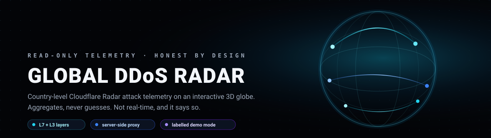
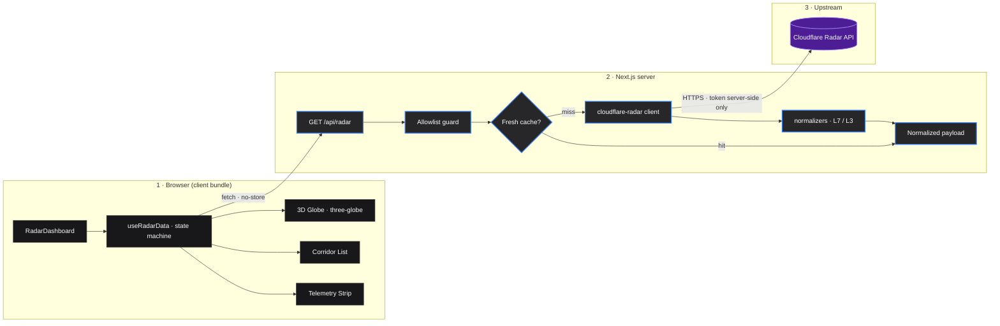
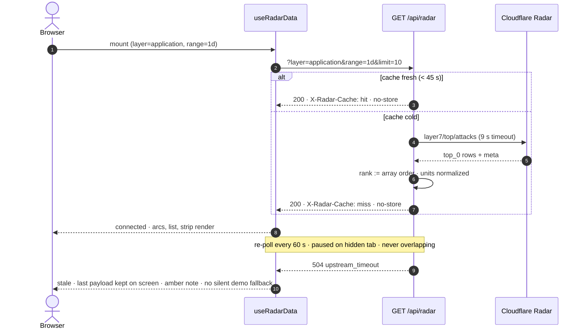

<h1 align="center">Global DDoS Radar</h1>

<p align="center">
  
</p>

<p align="center">
  <strong>A read-only, country-level view of Cloudflare Radar DDoS telemetry.</strong><br>
  The last dataset Radar published, rendered on an interactive 3D globe — never dressed up as more.
</p>

<p align="center">
  <a href="#the-thesis"></a>
  <a href="#request-lifecycle"></a>
  <a href="#stack"></a>
  <a href="#honesty-rules"></a>
  <a href="#accepted-limitations"></a>
  
</p>

---

> **🔒 READ-ONLY BY CONSTRUCTION** — No accounts. No database. No write paths. One page, one API route, one upstream. The only state this app keeps is a 45-second cache and the browser's last payload.

---

## The Thesis

DDoS telemetry ships as dense JSON — arrays of origin/target pairs, normalization metadata, and unit conventions buried in `meta`. Reading it raw tells you *that* attacks happened. It doesn't tell you *where they went*.

**Global DDoS Radar inverts the consumption.**

> **"This is not a real-time attack dashboard. It is the clearest possible view of the last dataset Cloudflare Radar published — labelled exactly as such."**

Switch the layer, switch the window, and the same corridors re-render in under a second: arcs across a dark globe, a ranked list beside it, and a telemetry strip that says precisely where every number came from — or refuses to render and tells you why.

```text
 ┌──────────────┐      ┌──────────────┐      ┌──────────────┐      ┌──────────────┐
 │    FETCH     │ ───► │      SEE      │ ───► │   INSPECT    │ ───► │    TRUST     │
 │ Radar API    │      │ Globe + list  │      │ Rank · units │      │ Provenance   │
 │ allowlisted  │      │ one selection │      │ per row      │      │ always shown │
 └──────────────┘      └──────────────┘      └──────────────┘      └──────────────┘
```

---

## What Ships in v1.0

These capabilities are **complete, tested, and live** in the current build:

| # | Capability | Status |
|---|---|---|
| 1 | **Server-Side Proxy** — the Radar token exists only on the server; the browser talks to `/api/radar` | ✅ Live |
| 2 | **Query Allowlists** — `layer`, `range`, and `limit` rejected unless explicitly allowed | ✅ Live |
| 3 | **Hard Timeout** — 9 s upstream `AbortController`, never a hung page | ✅ Live |
| 4 | **Best-Effort Cache** — 45 s in-memory upstream cache, honest `X-Radar-Cache: hit/miss` | ✅ Live |
| 5 | **L7 Corridors** — origin → target arcs from `layer7/top/attacks` | ✅ Live |
| 6 | **L3 Origin Markers** — no target is invented where the API returns none | ✅ Live |
| 7 | **Rank From Order** — the API returns no `rank`; the UI says "rank" and derives it from array order | ✅ Live |
| 8 | **Honest Units** — share of mitigated L7 requests; L3 respects `meta.normalization` | ✅ Live |
| 9 | **Telemetry Strip** — layer, window, provenance readouts, and Radar's own `lastUpdated` when present | ✅ Live |
| 10 | **Corridor List** — keyboard operable, labelled rows, selection shared with the globe | ✅ Live |
| 11 | **Status Machine** — `loading / connected / stale / unavailable / demo`, each rendered distinctly | ✅ Live |
| 12 | **Stale Keeps Data** — a failed poll keeps the last payload on screen with an amber note, never blanks | ✅ Live |
| 13 | **Labelled Demo Mode** — deterministic sample corridors behind a non-dismissible **DEMO DATA — NOT LIVE** banner | ✅ Live |
| 14 | **WebGL Fallback** — no-WebGL browsers get the list and strip, not a blank canvas | ✅ Live |
| 15 | **Reduced Motion** — auto-rotate and arc animation disabled under `prefers-reduced-motion` | ✅ Live |
| 16 | **Polite Polling** — 60 s cadence (30 s floor), paused on hidden tabs, no overlapping requests | ✅ Live |
| 17 | **UTC Timestamps** — every absolute time rendered in UTC, fixed `en-GB` locale | ✅ Live |
| 18 | **Validated Geometry** — generated country borders pre-checked against H3, so the globe cannot crash on unrenderable polygons | ✅ Live |
| 19 | **38-Test Vitest Suite** — normalizers, upstream client, route handler, hook state machine, arcs, formatting, list | ✅ Live |

### 🔒 Intentionally Not Built

| Feature | Reason |
|---|---|
| **L7 Trend Sparkline** — the plan's P1 chart | The time-series response semantics couldn't be verified against the live API; a chart that might mislabel its axes is worse than no chart |
| **Threshold Alerts** | Radar publishes aggregates, not events. Alerting would imply event-level monitoring this data cannot honestly provide |
| **Historical Playback** | Reprocessing aggregates across time changes their meaning; features must not outrun the data's semantics |
| **Accounts / Persistence** | Read-only by construction. Every write path is an attack surface; this app has none |
| **Alternate 2D Map View** | Globe + ranked list covers the job; a second view is maintenance without user value |

---

## System Architecture



### Repository Structure

```text
ddos/
├── app/
│   ├── api/radar/route.js        # The only route: allowlist → cache → upstream → normalize
│   ├── globals.css               # Dark-only design tokens
│   ├── layout.js                 # Metadata, theme color, dark shell
│   └── page.js                   # Renders RadarDashboard
├── components/
│   ├── ui/globe.jsx              # Aceternity globe (three.js / three-globe)
│   ├── radar-dashboard.jsx       # Page composition, selection state
│   ├── radar-globe.jsx           # Client-only wrapper, WebGL fallback, error boundary
│   ├── corridor-list.jsx         # Ranked, keyboard-operable rows
│   ├── layer-switcher.jsx        # Layer / window radiogroups with arrow-key nav
│   ├── demo-banner.jsx           # One-line DEMO DATA — NOT LIVE marker
│   └── icons.jsx                 # Inline SVG, zero icon dependencies
├── hooks/use-radar-data.js       # Fetch lifecycle, cache keys, polling, staleness
├── lib/
│   ├── radar-config.js           # Allowlists, error codes, demo payload, arc styles
│   ├── cloudflare-radar.js       # The only file that touches api.cloudflare.com
│   ├── normalize-radar.js        # L7 / L3 adapters, rank, honest units
│   ├── arcs.js                   # Geo → arc/marker geometry
│   ├── format.js                 # UTC time, locale-pinned formatters
│   └── country-centroids.js/.json# Generated ISO2 → centroid table
├── data/globe.json               # Generated Natural Earth borders (H3-validated)
├── scripts/generate-data.mjs     # Regenerates globe.json + centroids, checks H3 renderability
├── tests/                        # 7 suites · 38 tests
├── assets/banner.svg
└── README.md                     # This file
```

---

## Request Lifecycle

One poll, from keystroke to pixels — including the two paths that usually get hidden:



---

## The Data Contract

Where the honesty lives — the two layers disagree, and the UI refuses to paper over it:

| | Application (L7) | Network (L3) |
|---|---|---|
| Radar endpoint | `radar/attacks/layer7/top/attacks` | `radar/attacks/layer3/top/attacks` |
| Row shape | origin **→** target | origin only |
| Rendered as | corridor arc | origin marker (start = end) |
| Rank | derived from array order — API returns none | derived from array order |
| Metric | share of mitigated L7 attack requests | normalized per `meta.normalization` |
| Caveat | — | location = Cloudflare data-center, source IPs are spoofable; **not** a verified attacker location |

### Error Taxonomy

Every failure is a code, never a mystery:

| Code | HTTP | Meaning |
|---|---|---|
| `invalid_query` | 400 | `layer` / `range` / `limit` failed the allowlist |
| `token_missing` | 503 | no `CLOUDFLARE_RADAR_API_TOKEN` and demo mode off |
| `upstream_auth` | 502 | Cloudflare rejected the token or permission |
| `upstream_rate_limit` | 429 | Radar rate limit hit — `Retry-After` forwarded |
| `upstream_timeout` | 504 | no upstream response within 9 s |
| `upstream_unavailable` | 502 | network failure or non-JSON upstream |
| `upstream_invalid` | 502 | upstream payload failed the normalizer contract |

---

## Stack

| Layer | Technologies | Rationale |
|---|---|---|
| **Framework** | Next.js 16 (App Router, Cache Components), React 19, Tailwind CSS v4 | Server route for the token boundary; static shell, dynamic data |
| **Visualization** | three.js, three-globe, `@react-three/fiber` ^9, `@react-three/drei` | Mature globe rendering with a pinned, stable fiber major |
| **Data Source** | Cloudflare Radar API (read-only) | Authoritative, country-level DDoS aggregates |
| **Geometry** | Natural Earth (public domain) via `world-atlas`, `world-countries` (ODbL), H3 | Generated offline, validated for renderability, shipped as static JSON |
| **Testing** | Vitest, Testing Library, jsdom | 38 tests across 7 suites; the route handler and hook are exercised for real |
| **Linting** | ESLint (`eslint-config-next`) | Zero-warning baseline |

## Getting Started

### Prerequisites

- **Node.js** `>= 20` and npm
- A Cloudflare API token with **Cloudflare Radar: Read** — create one at
  <https://dash.cloudflare.com/profile/api-tokens> (template "Read all resources", or a custom
  token with _Cloudflare Radar → Read_)

### Setup

```bash
npm install --legacy-peer-deps   # see note below
cp .env.example .env.local
# Fill: CLOUDFLARE_RADAR_API_TOKEN=your-token-here
npm run dev                      # http://localhost:3000
```

> `--legacy-peer-deps` is needed because the shadcn registry's Aceternity globe pulls
> `@react-three/fiber@10.0.0-alpha`, which conflicts with `@react-three/drei`'s `^9` peer range.
> This project pins the stable `@react-three/fiber@^9` instead.

The token is read **server-side only** by `app/api/radar/route.js` and never appears in any
response or client bundle.

Production: `npm run build && npm run start`. `NEXT_PUBLIC_*` values are inlined at build time —
change them and rebuild, don't expect a restart to pick them up.

### Demo Mode

No token? Preview the UI with clearly labelled sample corridors:

```ini
RADAR_DEMO_MODE=true             # server: deterministic sample corridors
NEXT_PUBLIC_RADAR_DEMO_MODE=true # client: renders sample rows without calling the API
```

Demo runs are locked behind a permanent **DEMO DATA — NOT LIVE** banner, and a failed live
request never silently falls back to sample data.

---

## Honesty Rules

The non-negotiables this codebase is built around:

1. **Never claim real-time.** The view reflects the last dataset Radar published, on Radar's cadence.
2. **"Last updated" means Radar said so.** If the API returns `meta.lastUpdated`, show it — otherwise label the time "Fetched at".
3. **No invented targets.** L3 returns origins only; L3 renders origins only.
4. **No invented ranks.** The API returns no `rank` field; ordering is derived and documented.
5. **Failure is loud.** Errors render as codes and stale data stays labelled — never blank, never fake.
6. **Demo is always visible.** A demo payload can never be mistaken for live data.
7. **UTC everywhere.** No local-time ambiguity in absolute timestamps.

## Design Language

Dark, quiet, and deliberately restrained — one accent per layer, everything else is structure:

| Token | Value | Usage |
|---|---|---|
| Background | `#030407` | Page canvas |
| Panel | `#080C14` | Cards, list surface |
| Foreground | `#F3F6FC` | Primary text |
| Muted text | `#9BA7B8` | Secondary labels, provenance |
| L7 accent | `#06B6D4` | Application-layer arcs |
| L3 accent | `#3B82F6` | Network-layer markers |
| Selection | `#A5F3FC` | Selected corridor + focus ring |
| Status dots | `#34D399` / `#FBBF24` / `#F43F5E` / `#A78BFA` | connected / stale / unavailable / demo |
| Stale notice | amber | Keeps last data on screen, warns instead of blanks |

---

## Testing

```bash
npm test          # vitest run — 7 suites, 38 tests
npm run test:watch
npm run lint      # zero-warning baseline
npm run build     # production build must stay green
```

| Suite | Covers |
|---|---|
| `normalize-radar` | L7/L3 adapters, rank-from-order, unit handling, malformed payloads |
| `cloudflare-radar` | Upstream client, timeout, auth/rate-limit mapping |
| `api-radar-route` | Allowlists, error codes, demo branch, cache headers |
| `use-radar-data` | State machine, keyed cache, staleness, no-overlap requests |
| `arcs` | Geo → arc geometry, L3 marker path |
| `format` | UTC formatting, locale pinning |
| `corridor-list` | Row rendering, labels, keyboard interaction |

## Data & Attribution

- **Country borders** — Natural Earth 110m (public domain) via `world-atlas`, generated into `data/globe.json`.
- **Country centroids** — `world-countries` (mledoze/countries, ODbL-1.0), generated into `lib/country-centroids.json`.
- **Telemetry** — [Cloudflare Radar](https://radar.cloudflare.com/) (read-only, cache-respecting).
- Regenerate all geometry: `npm run generate:data` (validates every polygon part against H3 before writing).

## Accepted Limitations

- **Polling, not push.** Radar has no event stream; the app polls on Radar's cadence and says so.
- **L3 provenance.** Origin locations are data-center locations and spoofable; the UI states this next to the data.
- **The trend chart is absent on purpose.** Its semantics were unverifiable; see *Intentionally Not Built*.
- **Two windows only (1d / 7d).** The selector offers exactly the ranges that are validated end-to-end; more ship only with matching tests.

---

<p align="center">
  <sub>Global DDoS Radar v1.0 · Read-only · Aggregates, never guesses · Engineered for clarity, not hype.</sub>
</p>
